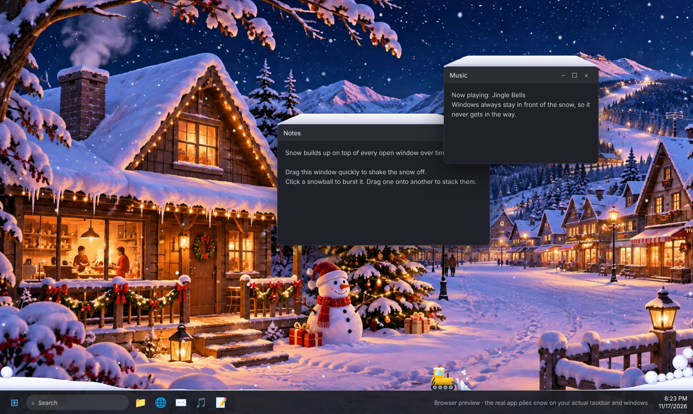

# Snowly ❄

A winter desktop for Windows: a 4K snowy village wallpaper, falling snow, snow that piles up on the taskbar and on top of every open window, snowballs you can play with, and a little yellow snowplow that pushes the snow into drifts.

All of it lives **behind your windows**, so it never gets in the way of your work.



## Features

- **Stays behind your work.** Snowly draws on a layer directly above the desktop and below every app window. Clicks go straight through to your desktop icons, except when you click a snowball.
- **Snow on every window.** Snow builds up along the top edge of each open window over time, and a window fills up in about 8 minutes. The snow moves with the window, and dragging a window quickly shakes it off. Maximized windows don't collect snow.
- **Snow on the taskbar.** Flakes that reach the taskbar stay there. Snow slides when a slope gets too steep, so the drifts form natural slopes and mounds.
- **Snowballs.** Snowballs sit on the taskbar snow, and new ones roll up over time.
  - Click a snowball to burst it. The snow falls back onto the ground.
  - Drag a snowball to move it, or throw it.
  - Drop one snowball onto another to stack them. You can also put one on top of a window.
- **A snowplow that really pushes.** Snow in front of the blade builds into a growing wedge, and the plow slows down as the load gets heavier. Once the pile is taller than the blade, clumps tumble over the top. At the edge of the screen the plow leaves a drift, backs up, turns around and plows the other way. It also shoves snowballs along.
- **4K winter wallpaper.** On first run Snowly sets `wallpaper.png` as your Windows wallpaper. Your previous wallpaper is remembered, so you can switch back with one click.

Because everything sits behind your windows, a maximized window covers the taskbar snow and the plow. They show up again when you restore or minimize the window.

## Download (no Node.js needed)

1. Download `Snowly-win-x64.zip` from the latest **Release**.
2. Unzip it and run `Snowly.exe`.

Every push to `main` builds the app and publishes a release named after the version in `package.json` (for example `v1.2.0`). To ship a new release, bump `version` and push.

> The app is not code-signed, so Windows SmartScreen may warn you the first time. Click **More info → Run anyway**.

## Change the wallpaper

Replace **`wallpaper.png`** with any image you like. Keep the name `wallpaper.png`. A 3840 × 2160 image looks best.

- In the downloaded app, `wallpaper.png` is in the same folder as `Snowly.exe`.
- When running from source, it is in the project folder.

Snowly notices the new file within a few seconds and sets it as your wallpaper. You don't need to restart anything.

## Run from source

1. Install Node.js LTS from https://nodejs.org
2. Open a terminal in the project folder and run:

```bash
npm install
```

```bash
npm start
```

Afterwards you can double-click `start-hidden.vbs` to start Snowly without a console window.

To build the `.exe` yourself:

```bash
npm run pack
```

The app is written to `dist\Snowly-win32-x64\`, with `wallpaper.png` next to `Snowly.exe`.

## Tray menu

Click the ❄ icon in the notification area:

| Item | What it does |
|---|---|
| Snowfall | Off / Light / Medium / Heavy. "Off" stops new snow but keeps the snow that's already there |
| Snowplow / Snowplow size | Turn the plow on or off, change its size |
| Clear snow | Remove the snow from the taskbar and all windows |
| Winter wallpaper | Checked: use `wallpaper.png`. Unchecked: go back to your previous wallpaper |
| Restore my previous wallpaper | Switch back to the wallpaper you had before Snowly |
| Pause | Freeze the animation |
| Show / hide | Also **Ctrl + Alt + S** |
| Start with Windows | Launch Snowly when you sign in |
| Quit | Close Snowly |

Settings are saved in `%APPDATA%\snowly\settings.json`.

## How it works

- `main.js` creates a transparent window over the desktop work area, so its bottom edge is the top of the taskbar. Every 250 ms it moves this window directly above the desktop, below all app windows.
- `winapi.js` calls the Windows API through [koffi](https://koffi.dev), a prebuilt FFI library, so nothing has to be compiled. It lists the visible app windows in z-order every 50 ms. The page uses that list to pile snow on window tops and to know which parts are covered.
- `renderer/snow.js` simulates and draws the snow:
  - Each surface is a height map. Snow slides when a slope passes the angle of repose.
  - The plow's body is solid, so the snow it meets is pushed ahead of the blade.
  - Snowballs are circles with gravity, sticky contacts with each other, and resting contacts with the snow surfaces.
- Clicks normally pass through the Snowly window. The page still receives mouse-move events, and while the pointer is over a snowball it asks the app to accept clicks.

## Project layout

```
main.js                Snowly window, tray menu, shortcut, autostart, wallpaper, window tracking
winapi.js              Windows API calls (window list, keeping Snowly behind app windows)
preload.js             Bridge between the app and the page
renderer/snow.js       Snow physics and drawing
renderer/index.html    The Snowly page. Opened in a browser it shows a preview
renderer/demo.js       Browser preview only: sample windows you can drag
wallpaper.png          The wallpaper. Replace it to use your own
web/index.html         Original browser version (Mac-style desktop with snowmen)
scripts/               Packaging helper and a CI check for the Windows API calls
.github/workflows/     Builds the Windows app and publishes releases
```

Browser preview: open `renderer/index.html`. Add `?fast=4` to the address to play it at 4× speed.

To change how the snow behaves, edit the constants at the top of `renderer/snow.js`:

- `REPOSE`: how steep a drift can get
- `SNOW_RATE`: how fast snow builds up on the taskbar
- `WIN_RATE`: how fast snow builds up on windows
- `WMAX`: the deepest snow a window can hold
- `BLADE_H`: blade height

## Known limitations

- Primary monitor only.
- If the taskbar is on the side or top of the screen, snow collects along the bottom edge of the screen instead.
- Snow on a window is drawn just above its top edge. If another window overlaps that strip, the overlapping window hides the snow there.
- The included wallpaper was upscaled to 4K from a 1671 × 941 image with an AI super-resolution model (EDSR ×4). It is sharper than a plain resize, but it does not have the detail of a native 4K image.
